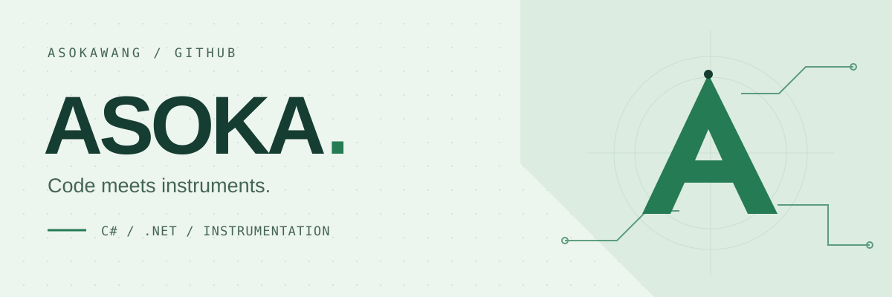

<picture>
  <source media="(prefers-color-scheme: dark)" srcset="./assets/banner-dark.svg">
  <source media="(prefers-color-scheme: light)" srcset="./assets/banner-light.svg">
  
</picture>

  <a href="https://github.com/AsokaWang?tab=repositories">Repositories</a>
  &nbsp; · &nbsp;
  <a href="https://github.com/AsokaWang/seremote-control">Instrument tools</a>
  &nbsp; · &nbsp;
  <a href="https://github.com/AsokaWang/CLR_via_CSharp">C# reading</a>

### 你好，我是 Asoka

这里放着我的仪器调试项目，以及 C# / .NET 相关的学习资料。

从代码到仪器，把具体问题一点点理清楚。

## 01 / Projects

### [seremote-control ↗](https://github.com/AsokaWang/seremote-control)

梅特勒 pH 调试工具。基于 C# 与 .NET Framework 4.8 的桌面项目。

`C#` `NET Framework` `Instrument tooling`

## 02 / Reading

### [CLR via C# ↗](https://github.com/AsokaWang/CLR_via_CSharp)

《CLR via C#》第四版相关资料，保留在这里便于阅读和查找。

Fork 自 <a href="https://github.com/fhlsteven/CLR_via_CSharp">fhlsteven/CLR_via_CSharp</a>，原作者与来源见仓库说明。

---

AsokaWang · Code, instruments &amp; notes.
